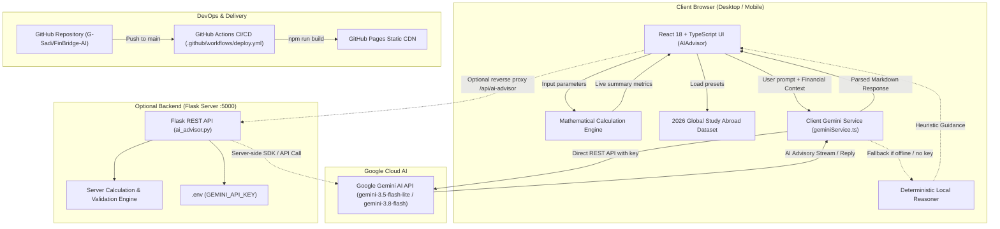

<div align="center">

# 🌉 FinBridge-AI

### **Intelligent AI-Powered Study Abroad Financial Advisory & FinTech Analytics Platform**

[](https://g-sadi.github.io/FinBridge-AI/)
[](https://github.com/G-Sadi/FinBridge-AI)
[](https://github.com/G-Sadi/FinBridge-AI)
[](https://github.com/G-Sadi/FinBridge-AI)
[](https://github.com/G-Sadi/FinBridge-AI/actions)
[](https://github.com/G-Sadi/FinBridge-AI/commits/main)

**[🚀 Launch Live Application](https://g-sadi.github.io/FinBridge-AI/)** · **[🐛 Report a Bug](https://github.com/G-Sadi/FinBridge-AI/issues)** · **[💡 Request a Feature](https://github.com/G-Sadi/FinBridge-AI/issues)** · **[📖 Documentation](#-table-of-contents)**

</div>

---

## 📋 Table of Contents

- [Executive Overview & Problem Statement](#-executive-overview--problem-statement)
- [Key Features & Capabilities](#-key-features--capabilities)
- [System Architecture](#-system-architecture)
- [Tech Stack Breakdown](#-tech-stack-breakdown)
- [Repository Structure](#-repository-structure)
- [Getting Started & Local Development](#-getting-started--local-development)
  - [Prerequisites](#prerequisites)
  - [Step 1: Clone Repository](#step-1-clone-repository)
  - [Step 2: Frontend Setup (Vite / React)](#step-2-frontend-setup-vite--react)
  - [Step 3: Backend Setup (Python Flask)](#step-3-backend-setup-python-flask-optional)
  - [Step 4: Gemini AI Key Configuration](#step-4-gemini-ai-key-configuration)
  - [Alternative: Serve Static Distribution](#alternative-serve-static-distribution)
- [Verified API Testing](#-verified-api-testing)
- [Deployment & CI/CD Pipeline](#-deployment--cicd-pipeline)
- [Roadmap](#-roadmap)
- [Contributing](#-contributing)
- [Author & Credits](#-author--credits)
- [License](#-license)

---

## 📖 Executive Overview & Problem Statement

Planning higher education abroad is one of the most high-stakes financial decisions a student or family can make. Prospective international students face a fragmented, high-friction planning environment:

- **Volatile Foreign Exchange (FX) Rates:** Inability to accurately convert domestic savings into destination currencies.
- **Strict Visa Proof-of-Funds Compliance:** Navigating complex country mandates such as Canadian Guaranteed Investment Certificates (GIC), German Blocked Accounts (*Sperrkonto*), US F-1 Form I-20 requirements, and UK UKVI maintenance regulations.
- **Hidden Relocation & Setup Costs:** Unforeseen initial expenses such as flights, visa fees, health insurance premiums, and rental deposits.
- **Ambiguous Work Offsets:** Unrealistic projections regarding legal student working hours and off-campus wage potential.

**FinBridge-AI** bridges this critical gap. Built as an enterprise-grade, lightweight FinTech web application and AI advisory suite, FinBridge-AI delivers **real-time mathematical cost modeling**, **multi-currency conversion**, and **context-aware conversational guidance powered by Google Gemini AI**. 

Whether deployed statically with zero infrastructure overhead on **GitHub Pages** or as a full-stack dual-tier application with a Python Flask service, FinBridge-AI empowers students with immediate, transparent, and actionable financial roadmaps.

---

## ✨ Key Features & Capabilities

| Feature Pillar | Technical & Architectural Implementation |
| :--- | :--- |
| **🤖 FinBridge AI Advisor** | Client-side and server-side **Google Gemini AI** integration engineered with domain-specific prompt guardrails. Delivers real-time advice on funding gap mitigation, scholarship opportunities, living budget optimization, and visa proof-of-funds compliance. Includes a deterministic local fallback engine for 100% uptime. |
| **📊 Real-Time Financial Engine** | Dynamic mathematical calculation engine computing: **Total Estimated Cost**, **Total Tuition**, **Living Expense Projections**, **Initial Moving Costs**, **Currency Conversion**, **Net Funding Gap**, and **Financial Coverage Ratio (%)**. |
| **🌍 2026 Global Dataset Presets** | Instant one-click presets with authentic 2026 data for top study destinations: **Toronto, Canada** (CAD / BDT), **Boston, USA** (USD / BDT), **Manchester, UK** (GBP / BDT), **Melbourne, Australia** (AUD / BDT), and **Berlin, Germany** (EUR / BDT). |
| **🔐 Zero-Leak Security Architecture** | Production-ready credential handling with public API key input UI completely removed. Automatically loads API keys via Vite environment variables (`VITE_GEMINI_API_KEY`), GitHub Actions Secrets, or local `.env` backend configurations. |
| **⚡ Smart Auto-Collapsing UX** | Distraction-free interface that automatically collapses the financial parameters drawer when the chat input receives focus, maximizing viewport readability on mobile and desktop screens. |
| **💬 1-Click Action Chips** | Instant suggestion chips to trigger common complex financial queries (e.g., *"How do I bridge my funding gap?"*, *"Calculate 24h work offset"*, *"Visa financial requirements"*, *"Break down my monthly living cost"*). |
| **🎨 Modern Cross-Browser UI** | Glassmorphic design system built with CSS custom properties, Manrope & DM Sans typography, responsive flex/grid layouts, and standards-compliant gradient typography (dual `-webkit-background-clip: text` and standard `background-clip: text`). |
| **🚀 Automated CI/CD Pipeline** | Zero-downtime automated deployment to GitHub Pages on every push to `main` via a declarative GitHub Actions workflow. |

---

## 🏛️ System Architecture

FinBridge-AI supports both a **serverless client-first architecture** (optimized for static hosting on GitHub Pages) and a **decoupled full-stack architecture** (with an optional Flask backend API).



---

## 🛠️ Tech Stack Breakdown

| Domain | Technology | Description & Purpose |
| :--- | :--- | :--- |
| **Frontend Framework** | **React 18** (`^18.3.1`) | Component-driven declarative UI rendering and dynamic state management |
| **Language & Typing** | **TypeScript** (`~5.6.2`) | Strict type checking, interface safety, and maintainable data contracts |
| **Build Tool & Bundler** | **Vite** (`^5.4.9`) | Lightning-fast HMR dev server and optimized production Rollup bundling |
| **Styling & Design** | **Modern CSS3** | Custom design tokens, glassmorphism, responsive grid, standards-compliant `background-clip` |
| **AI Advisory Engine** | **Google Gemini AI** | High-speed contextual reasoning (`gemini-3.5-flash-lite`, `gemini-3.8-flash`) |
| **Optional Backend** | **Python Flask** (`3.0+`) | Decoupled RESTful microservice with CORS support and payload sanitization |
| **CI/CD & Deployment** | **GitHub Actions + Pages** | Automated containerized workflow building and deploying static distribution |

---

## 📂 Repository Structure

```text
FinBridge-AI/
├── .github/
│   └── workflows/
│       └── deploy.yml              # GitHub Actions CI/CD automated deployment workflow
├── assets/                         # Compiled production distribution assets (JS/CSS bundles)
├── FinBridge-AI-Advisor/           # Core FinBridge AI Advisor application modules
│   ├── backend/                    # Python Flask backend microservice
│   │   ├── .env.example            # Environment variables template for Gemini API key
│   │   ├── .gitignore              # Backend-specific gitignore (virtualenvs, .env, __pycache__)
│   │   ├── ai_advisor.py           # Main Flask API, mathematical engine, and Gemini proxy
│   │   ├── app.py                  # Compatibility entrypoint invoking ai_advisor.py
│   │   └── requirements.txt        # Python dependencies (flask, flask-cors, python-dotenv)
│   ├── frontend/                   # React 18 + TypeScript source code
│   │   ├── src/
│   │   │   ├── AIAdvisor.css       # Glassmorphic styles, responsive breakpoints, background-clip
│   │   │   ├── AIAdvisor.tsx       # Interactive financial calculator & advisor chat component
│   │   │   ├── App.css             # Root application wrapper styles
│   │   │   ├── App.tsx             # Core application component
│   │   │   ├── geminiService.ts    # Client Gemini engine, 2026 RAG dataset & local reasoner
│   │   │   ├── index.css           # Global CSS resets and font imports
│   │   │   ├── main.tsx            # React DOM root initialization
│   │   │   └── vite-env.d.ts       # Vite TypeScript ambient declarations
│   │   ├── index.html              # Vite HTML development template
│   │   ├── package.json            # Frontend package dependencies and scripts
│   │   ├── tsconfig.json           # TypeScript compiler configuration
│   │   └── vite.config.ts          # Vite configuration (relative base, reverse proxy)
│   ├── deploy.yml                  # Modular deployment configuration
│   └── README.md                   # Detailed advisor technical documentation
├── .gitignore                      # Workspace-wide Git exclusion rules
├── index.html                      # Root entrypoint for direct GitHub Pages static hosting
└── README.md                       # Flagship project documentation and developer guide
```

---

## 🚀 Getting Started & Local Development

### Prerequisites

Ensure you have the following installed on your local machine:
- **Node.js**: v18.0.0 or higher (v20+ recommended)
- **npm**: v9.0.0 or higher
- **Python**: v3.10 or higher *(only required if running the optional Flask backend)*

---

### Step 1: Clone Repository

```bash
git clone https://github.com/G-Sadi/FinBridge-AI.git
cd FinBridge-AI
```

---

### Step 2: Frontend Setup (Vite / React)

Navigate into the frontend application directory, install packages, and launch the Vite development server:

```bash
cd FinBridge-AI-Advisor/frontend

# Install dependencies
npm install

# Start Vite HMR development server
npm run dev
```

The application will be accessible at: `http://localhost:5173/`

To build the static distribution:
```bash
npm run build
```

---

### Step 3: Backend Setup (Python Flask — Optional)

If you wish to test the decoupled Python REST API locally:

```bash
cd FinBridge-AI-Advisor/backend

# Create and activate a virtual environment
python -m venv venv

# On Windows:
.\venv\Scripts\activate
# On macOS / Linux:
source venv/bin/activate

# Install dependencies
pip install -r requirements.txt

# Run the Flask development server
python ai_advisor.py
```

The Flask server will start at: `http://localhost:5000/`

---

### Step 4: Gemini AI Key Configuration

FinBridge-AI is architected with a **zero-leak** design. You can configure your Google Gemini API key through any of the following mechanisms:

1. **Frontend Environment Variable (`FinBridge-AI-Advisor/frontend/.env`):**
   ```env
   VITE_GEMINI_API_KEY=your_actual_gemini_api_key
   ```
2. **Backend Environment Variable (`FinBridge-AI-Advisor/backend/.env`):**
   ```env
   GEMINI_API_KEY=your_actual_gemini_api_key
   GEMINI_MODEL=gemini-3.5-flash-lite
   FLASK_PORT=5000
   ```
3. **Local Offline Mode:**
   If no API key is provided, FinBridge-AI automatically activates its built-in **Deterministic Local Reasoner**, providing complete financial analysis and guidance without external API dependencies.

---

### Alternative: Serve Static Distribution

You can also run the pre-compiled root production distribution using any lightweight HTTP server:

```bash
# Using Node.js npx serve:
npx serve .

# Using Python 3:
python -m http.server 8080
```
Open your browser and navigate to `http://localhost:8080/`.

---

## 🧪 Verified API Testing

When running the Flask backend (`ai_advisor.py`), you can verify endpoints using PowerShell or cURL:

### 1. Health Check (`GET /api/health`)

```powershell
Invoke-RestMethod -Uri "http://localhost:5000/api/health" -Method Get | ConvertTo-Json
```

**Sample Response:**
```json
{
  "mode": "mock",
  "model": "none (mock)",
  "service": "FinBridge AI Study Abroad Finance Advisor",
  "status": "ok",
  "timestamp": "2026-11-10T19:50:00.000000+00:00"
}
```

---

### 2. AI Advisor Query (`POST /api/ai-advisor`)

```powershell
$body = @{
    message = "How do I calculate and close my funding gap for Toronto?"
    context = @{
        destination = "Toronto, Canada"
        university = "University of Toronto"
        destCurrency = "CAD"
        homeCurrency = "BDT"
        tuitionPerYear = 45000
        monthlyLiving = 1700
        studyDurationMonths = 24
        initialExpenses = 4200
        availableFunds = 8000000
        exchangeRate = 0.0112
    }
} | ConvertTo-Json -Depth 5

Invoke-RestMethod -Uri "http://localhost:5000/api/ai-advisor" -Method Post -ContentType "application/json" -Body $body | ConvertTo-Json -Depth 5
```

---

## 🔄 Deployment & CI/CD Pipeline

FinBridge-AI utilizes **GitHub Actions** for zero-configuration, continuous deployment to **GitHub Pages**.

### CI/CD Workflow (`.github/workflows/deploy.yml`)

Every push to the `main` branch triggers an automated build pipeline:
1. **Checkout Repository:** Fetches the latest source code.
2. **Node.js Environment Setup:** Initializes Node.js v20 with dependency caching.
3. **Frontend Compilation:** Resolves the workspace (`FinBridge-AI-Advisor/frontend` or `frontend`), installs clean npm packages, and executes `npm run build`.
4. **Artifact Staging:** Bundles the compiled `dist/` directory into a GitHub Pages deployment artifact.
5. **Zero-Downtime Deployment:** Deploys the static bundle directly to the `github-pages` environment.

The live application is published at:
👉 **[https://g-sadi.github.io/FinBridge-AI/](https://g-sadi.github.io/FinBridge-AI/)**

---

## 🗺️ Roadmap

- [x] **Client-Side Gemini Engine:** Direct integration with Google Gemini Flash models.
- [x] **2026 Study Abroad Knowledge Base:** Preloaded visa proof-of-funds and cost benchmarks.
- [x] **Smart Drawer UX:** Auto-collapsing parameters card on chat interaction.
- [x] **Standards-Compliant CSS:** Fully validated gradient typography and responsive glassmorphism.
- [ ] **Live FX Rate Integration:** Real-time currency exchange rates via Open Exchange Rates / Frankfurter API.
- [ ] **Export to PDF:** 1-click printable financial summary and visa proof-of-funds roadmap.
- [ ] **Scholarship Matching Engine:** Database of international merit-based and need-based awards.
- [ ] **Multi-Language Support:** Regional language localization (Bengali, Hindi, Spanish, Mandarin).

---

## 🤝 Contributing

Contributions make the open-source community an amazing place to learn, inspire, and create. Any contributions you make are **greatly appreciated**.

1. **Fork the Project**
2. **Create your Feature Branch:**
   ```bash
   git checkout -b feat/amazing-feature
   ```
3. **Commit your Changes:**
   ```bash
   git commit -m "feat: add amazing feature"
   ```
4. **Push to the Branch:**
   ```bash
   git push origin feat/amazing-feature
   ```
5. **Open a Pull Request**

Please ensure your code complies with our TypeScript and styling conventions before submitting.

---

## 👤 Author & Credits

**G-Sadi**
- **GitHub:** [@G-Sadi](https://github.com/G-Sadi)
- **Repository:** [https://github.com/G-Sadi/FinBridge-AI](https://github.com/G-Sadi/FinBridge-AI)
- **Live Application:** [https://g-sadi.github.io/FinBridge-AI/](https://g-sadi.github.io/FinBridge-AI/)

---

## 📜 License

Distributed under the **MIT License**. See `LICENSE` for more information.

<div align="center">
  <sub>Built with ❤️ by <a href="https://github.com/G-Sadi">G-Sadi</a> · Powered by Google Gemini AI</sub>
</div>
